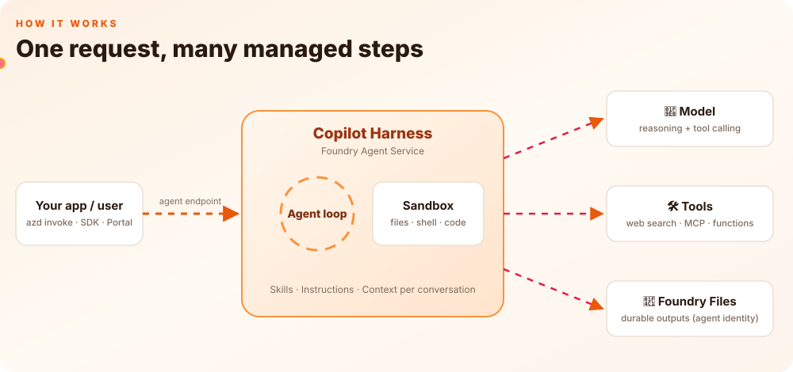

# Microsoft Copilot Harness in Foundry: Learning Kit

> **Write a skill in Markdown, wire it up in YAML, run `azd deploy`, and you get a production-shaped agent.**
> The **Microsoft Copilot harness** is the managed runtime that Microsoft Foundry runs *around* your prompt agent: the agent loop, a sandbox, context, files and tool orchestration. You don't have to build any of it.

<p align="center">
  
</p>

> ⚠️ **Preview.** The Copilot harness (`harness.type: microsoft_copilot_preview`) is in public preview. It has no SLA, and its behavior and APIs may change.

---

## ✅ When to use it

| 👍 Use the Copilot harness for | 👎 Skip it (for now) if |
|---|---|
| **Multi-step, tool-heavy tasks** like research, analysis or triage | You need **GA and an SLA** today |
| Work that needs **files and code execution** in a sandbox | You must bring **your own model** or runtime |
| **Fast, low-code builds** from just Markdown and YAML | You want **full custom code** (orchestration, frameworks) |
| Reusable know-how packaged as **skills** | A single **simple Q&A** prompt is all you need |

### Where it sits

```
 Simple ──────────────────────────────────────────────────────────── Full control
 Prompt agent            ⚡ Prompt agent + Copilot harness          Hosted agent
 Q&A, light tools        tools · files · sandbox · skills           your own code & container
```

**Rule of thumb:** start with a prompt agent. Add the **Copilot harness** once the agent needs to *do work*: run several steps, call tools, read and write files, or run code. Move to a **hosted agent** only when you need code-level control.

---

## 🤔 What problem does it solve?

Building a real agent usually means writing and running all of this yourself:

| Without the harness, you build… | With the harness, Microsoft runs… |
|---|---|
| A loop that plans → calls tools → reads results → repeats | 🔁 **Agent loop** |
| A safe place to create files and run shell or code | 📦 **Isolated sandbox** for each conversation |
| Conversation memory and context-window management | 🧠 **Context management** |
| Delegation to helper agents | 🤝 **Subagents** |
| Storage for outputs the agent creates | 📁 **Foundry Files** (agent identity) |
| Auth, RBAC, tracing and evaluation hooks | 🛡️ **Foundry governance** |

**You bring only three things:**

1. 📝 **Instructions**: who the agent is and how it should behave.
2. 🧩 **Skills**: reusable procedures written as `SKILL.md` files.
3. 🛠️ **Tools**: web search, MCP servers and functions.

You also pick a model that supports **reasoning and tool calling**, such as `gpt-6.1-terra`.

---

## 🚀 How it works in three steps

| Step | What you do | Artifact |
|---|---|---|
| **1** | Write the skill | `skills/<skill>/SKILL.md` |
| **2** | Define the agent and select the harness | `azure.yaml` (`kind: prompt`, `harness: microsoft_copilot_preview`) |
| **3** | Deploy and invoke | `azd deploy --all` → `azd ai agent invoke` |
| ↻ | Refine and redeploy | each deploy creates new **immutable versions** |

```bash
export AZD_ALPHA_ENABLE_AGENTS_MANAGED_HARNESS=true
azd ai agent init my-agent --harness microsoft_copilot_preview
azd deploy --all
azd ai agent invoke --new-conversation "Give me a research brief on <topic>"
```

---

## 💡 Example use cases

### From Microsoft (Learn and the official samples)

MS Learn describes the harness as being for *"multi-step tool, skill, file, or command workflows"*. Microsoft's [official harness samples](https://github.com/microsoft-foundry/foundry-samples/tree/main/samples/cli/prompt-agents/microsoft-copilot-harness) show what that looks like:

| | Official sample | What it shows | Why the harness, not a plain prompt agent or a hosted agent |
|---|---|---|---|
| 🔎 | [**Web Research**](https://github.com/microsoft-foundry/foundry-samples/tree/main/samples/cli/prompt-agents/microsoft-copilot-harness/quickstart-web-research) (the [Learn quickstart](https://learn.microsoft.com/azure/foundry/agents/quickstarts/create-web-research-agent?pivots=azd)) | Web Search plus a reusable official-sources **skill** | **For a quick cited summary, a plain prompt agent with web search is enough.** The harness pays off for *deep* research: the **Web** tool fetches **full pages**, notes are saved to files in the agent's **sandbox workspace** so many sources fit, **subagents** split up subtopics, and the brief comes back **as a file** |
| 📧 | [**Web Research Email Digest**](https://github.com/microsoft-foundry/foundry-samples/tree/main/samples/cli/prompt-agents/microsoft-copilot-harness/web-research-email-digest) | Web Search, then a **Work IQ Mail** email delivered on a daily schedule | A scheduled job runs **research → write → send** without a person in the loop. With a hosted agent you'd write and host that pipeline yourself |
| 🌐 | [**Browser Automation Blog Research**](https://github.com/microsoft-foundry/foundry-samples/tree/main/samples/cli/prompt-agents/microsoft-copilot-harness/browser-automation-blog-research) | Managed **browser sessions** (Playwright) through a toolbox | Handles sites that need real browsing (clicks, JavaScript-rendered pages) that search snippets can't cover, with no browser fleet to run |
| 🗄️ | [**AdventureWorks SQL Analyst**](https://github.com/microsoft-foundry/foundry-samples/tree/main/samples/cli/prompt-agents/microsoft-copilot-harness/adventureworks-sql-analyst) | **Read-only** SQL analysis through managed MCP connector tools, with a skill that loads instructions only as needed | Multi-step querying where the agent explores, queries and refines. Read-only tools and RBAC limit what it can touch |
| 📊 | [**CSV Chart Analyst**](https://github.com/microsoft-foundry/foundry-samples/tree/main/samples/cli/prompt-agents/microsoft-copilot-harness/csv-chart-analyst) (linked from Learn) | The uploaded CSV is placed in the workspace, analysed with **shell**, and returned as a PNG through **Foundry Files**, *without Code Interpreter* | Shows the harness's main difference most clearly: a **per-conversation workspace, shell commands and generated files**, saved under the agent's identity |

### Other patterns to consider (my suggestions, not from Microsoft docs)

These fit the harness's capabilities but **aren't documented Microsoft scenarios**. Validate them before using them with customers.

- 📄 **Document processing:** read → transform → write output files to Foundry Files.
- 🧰 **Ops runbooks:** a skill encodes the procedure, MCP tools act, and egress rules limit which hosts it can reach.
- 🤝 **Long multi-step tasks:** the agent loop delegates parts of the work to subagents (Learn: *"Delegate work to additional agents"*).

---

## 🆚 Why the harness? Prompt agent vs. + Copilot harness vs. hosted agent

You *can* build most of these with a plain prompt agent or a hosted agent. The harness sits in the middle: **hosted-agent capabilities with prompt-agent effort**.

| Capability | Prompt agent | **Prompt agent + Copilot harness** | Hosted agent |
|---|---|---|---|
| Authoring | Instructions + tools | **Instructions + tools + skills** (Markdown and YAML) | Your code and framework |
| Multi-step tool loop | Tool calling with declared tools | ✅ **Managed agent loop** | You build it |
| Per-conversation file workspace | ❌ | ✅ **Isolated, persists across turns**. This is a temporary folder in the Foundry sandbox, not your machine or SharePoint, and outputs worth keeping go to Foundry Files | You build it |
| Shell commands and file read/write | ❌ (Code Interpreter only) | ✅ **Built-in harness tools** | You build it |
| Subagents | ❌ | ✅ **Built in** | You build it |
| Return generated files | Through Code Interpreter | ✅ **Uploaded to Foundry Files with the agent's identity** | You build it |
| Network egress control | ❌ | ✅ **Allow and deny rules per host** | Your network setup |
| Runtime to operate | None | **None, because Foundry runs it** | Container, scaling, patching |
| Custom framework, middleware, own model | ❌ | ❌ | ✅ |

### 🛡️ Guardrails the harness gives you

| Guardrail | How the harness provides it |
|---|---|
| **Isolated execution** | Shell and code run in a **Foundry-managed sandbox**, never on your infrastructure, and each conversation has its own workspace |
| **Least-privilege tools** | Turn each harness tool (**file read, file write, shell, web, subagents**) on or off separately. For example, disable Shell for a read-only agent |
| **Network egress control** | Attach a guardrail policy with allow and deny rules per host to control outbound traffic from shell commands and the Web tool. Start in **Audit** mode, then switch to **Enforce** |
| **Identity, not secrets** | The agent has its own **Entra identity**, so file uploads and toolbox calls are authorized by RBAC (Foundry User role), not keys |
| **Human approval** | Customer MCP tools support `require_approval`. Approval for the harness tools themselves is managed by the service |
| **Versioned and auditable** | Skills and agents are **immutable versions**, and the usual Foundry project roles, policies and tracing all still apply |

> **In short:** choose a **prompt agent** for simple Q&A, the **Copilot harness** when the agent needs to *do work* (files, shell, multiple steps) safely without you running a runtime, and a **hosted agent** only when you need to own the code, the framework or the model.
>
> <sub>Source: [Use the Microsoft Copilot harness with prompt agents](https://learn.microsoft.com/azure/foundry/agents/how-to/use-tools-skills-copilot-harness), specifically "Understand what the harness changes", "Configure harness tools" and "Control network egress".</sub>

---

## ✅ Your security checklist

- 🐚 **Limit the shell.** Enable only the tools the agent really needs.
- 🪪 **Identity, not secrets.** Use the agent's Entra identity and RBAC, never keys in instructions.
- 🌐 **Control egress.** Restrict where the agent can reach.
- 🧪 **Treat content as data.** Web pages and files are untrusted input, not instructions.
- ✅ **Approve MCP calls.** Require approval for sensitive tools.
- 🔍 **Trace everything.** Use Foundry tracing and evaluations.

---

## 📦 What's in this repo

| File | Purpose |
|---|---|
| [`copilot_harness_learning.ipynb`](copilot_harness_learning.ipynb) | **Runnable notebook** following the official Learn flow: SKILL.md → azure.yaml → `azd deploy` → invoke (azd and SDK) → refine and redeploy → optional cleanup |
| [`build_notebook.py`](build_notebook.py) | Generates the notebook. Edit this file, then re-run it |
| [`assets/how-it-works.svg`](assets/how-it-works.svg) | The animated diagram above |
| [`.env.example`](.env.example) | Template for your Foundry project settings |

## ▶️ Run the notebook

**Prerequisites**

- An existing **Foundry project** in a region that supports the Copilot harness, such as **Sweden Central**, **East US** or **Canada Central**.
- A model deployed in that project that supports **reasoning and tool calling**.
- **Azure Developer CLI ≥ 1.37** (`brew install --cask azure/azd/azd` or `winget install microsoft.azd`) with the Foundry extensions.
- The Azure CLI, signed in with `az login` and `azd auth login`.
- Python 3.10+.

**Steps**

```bash
git clone https://github.com/anuragsirish/copilot-harness-learning.git
cd copilot-harness-learning
python -m venv .venv && source .venv/bin/activate
pip install jupyter nbformat pyyaml "azure-ai-projects>=2.10" azure-identity openai
cp .env.example .env      # fill in your subscription, resource group, Foundry resource and project
code copilot_harness_learning.ipynb   # or: jupyter lab
```

> 💡 **Tip:** To call a harness agent from the SDK, use `AIProjectClient(...).get_openai_client(agent_name=...)`. That is the **agent-scoped** endpoint. The project-level endpoint returns HTTP 400 for harness agents.

> 💸 Running the notebook **deploys a real agent and skill** to your project. Set `CLEANUP = True` in the last section to delete them afterwards.

## 📚 Learn more

- [Use the Microsoft Copilot harness with prompt agents](https://learn.microsoft.com/azure/foundry/agents/how-to/use-tools-skills-copilot-harness)
- [Quickstart: Create a web research agent (azd)](https://learn.microsoft.com/azure/foundry/agents/quickstarts/create-web-research-agent?pivots=azd)
- [Copilot harness limits, quotas and regions](https://learn.microsoft.com/azure/foundry/agents/concepts/limits-quotas-regions#microsoft-copilot-harness-preview)
- [Foundry blog: Microsoft Copilot harness in Foundry](https://devblogs.microsoft.com/foundry/microsoft-copilot-harness-in-foundry/)

---

<sub>Created by Anurag Karuparti · CSA, Principal AI Apps Architect</sub>
